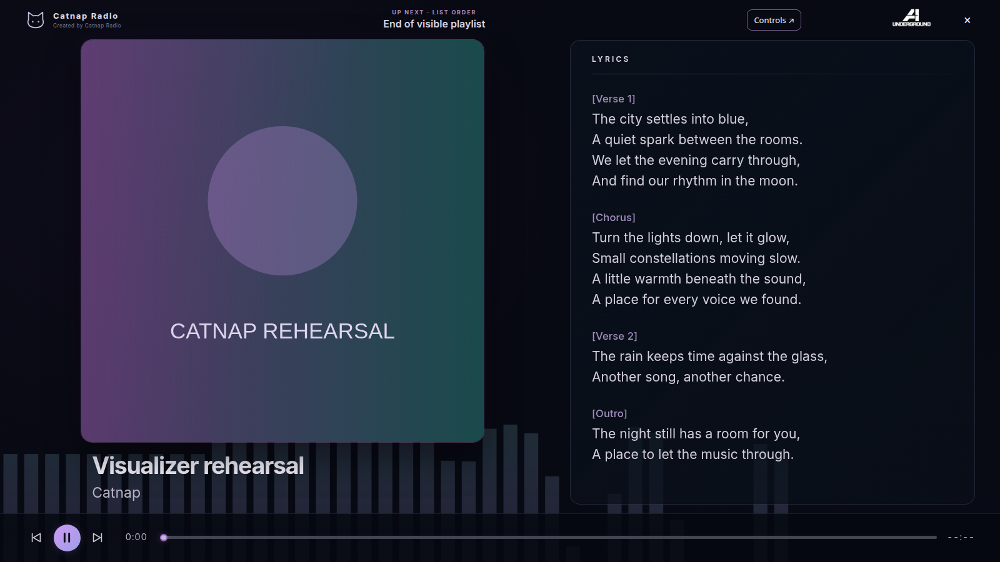

# Catnap Theatre

**0.6.9 development branch:** optional Inbox & Playlists, a separately packaged Catnap Inbox creator, mixed Suno/YouTube show order, uploader context/warnings and explicit manual Load/Play controls. See [managed show setup and verification limits](docs/MANAGED-SHOW.md). This branch does not replace the submitted 0.5.0 Store beta or activate a user's installed extension. Use a separate test profile.

**Catnap Theatre 0.5.0 · early access for Chrome and Brave.** Theatre options live in a persistent control window, with optional music-reactive background bars. Open Theatre → **Controls ↗** for layout, lyrics, visuals, branding, banners and visualizer settings. Closing the control window keeps Theatre running. See the [controls guide](docs/PRESENTATION-CONTROLS.md), [background bars guide](docs/BACKGROUND-VISUALIZER.md) and [broadcast pilot guide](docs/BROADCAST-PILOT.md).

A simple theatre overlay for people hosting Suno listening parties. Suno plays the music; Catnap displays the artwork, lyrics, visible playlist and host messages. No AI, Discord bot, uploader account, SSH tunnel or backend service is required.

[Download 0.5.0](https://github.com/inaratalamasca/catnap-theatre/releases/tag/v0.5.0) · [Project overview](https://github.com/inaratalamasca/catnap-studio) · [Listen](https://listen.catnapradio.com/)

**Early access, not a browser-store release.** Ina has used standalone 0.5.0 successfully in Brave. The integrated companion and compatible controller were also loaded and connected in the primary profile. The toolbar icon revision passed isolated browser checks. These observations do not complete every item in the [acceptance checklist](docs/ACCEPTANCE.md). Install or switch builds between shows, because extension reloads interrupt active capture.

*Original fixture artwork/lyrics in an isolated Chromium rehearsal. Bars sit behind the presentation at the default 20% opacity.*

## Try it between shows

1. Download and extract the ZIP from the [0.5.0 release](https://github.com/inaratalamasca/catnap-theatre/releases/tag/v0.5.0). Use a separate Chrome/Brave profile for your first test. Do not enable the older Catnap Theatre extension in the same test profile.
2. Open `chrome://extensions`, enable Developer mode and choose **Load unpacked**.
3. Select this repository’s **extension** folder.
4. Open a Suno playlist and sign in through Suno as usual. Press **Catnap Theater** near the lower right.
5. Start the playlist with its ordinary Play control. Open **Controls ↗** for the persistent control window. Playback, playlist navigation and Close remain on Theatre.

Installing in an already open Suno tab requires a safe page refresh. A refresh can interrupt music. Test before a show, never during a live track.

## What this preview contains

- Artwork + lyrics, playlist + artwork + lyrics, and artwork-focus layouts.
- Contained artwork; a muted copy of an available matching native Suno video, with still-image fallback.
- Approximate lyric following, manual scroll correction, retry, font size and optional `[section / metadata]` line hiding.
- A visible-row playlist that follows Suno’s rendered page without refreshing it; guarded native row Play controls and a current-song marker.
- Local warning/message/image/GIF/video overlays, expiry and recent-file reuse.
- Host name, background colour and tab-local logo/background-image customization; required AIU branding and Catnap creator credit remain visible.
- Extension-local preference storage and a small JSON settings import/export.
- One Controls entry opens a reusable presentation control window linked to its originating Suno tab, including layout, lyrics, branding, banners and local media.
- Optional translucent music-reactive bars behind foreground panels, using the existing HQ broadcast audio or safely exposed stream audio, with enable/opacity controls. URL-only playback without broadcasting stays quiet.
- Optional music-only broadcasting and bounded public now-playing metadata, independent of whether Theatre is open.
- A separate waiting/pre-show/after-show lounge with explicit Play/Stop AIU Radio, manual next-party text and an optional Suno playlist link.

The visible list is not Suno’s internal playback queue. It cannot promise unseen rows, a refreshed server-side playlist, true lyric timestamps or automatic external-video placeholders. These limits are part of the product contract, not hidden fallbacks.

When broadcasting with a compatible relay, public metadata includes the native
song title/artist, allowlisted Suno artwork, available native timing, a visible
playlist position and up to 100 following visible rows with known durations.
Unknown timing stays unknown; shuffle hides the following rows. The reader sends a five-second
heartbeat; the pilot server expires metadata after 30 seconds without a fresh
update. Audio continues independently if metadata is unavailable. The metadata
reader receives no publish token and cannot control playback.

## Read next

- [User guide and storage](docs/USER-GUIDE.md)
- [Persistent presentation controls](docs/PRESENTATION-CONTROLS.md)
- [Toolbar identity and pinning](docs/TOOLBAR-ICON.md)
- [Background music bars](docs/BACKGROUND-VISUALIZER.md)
- [Every requested feature: status and acceptance](docs/REQUIREMENTS.md)
- [Architecture and boundaries](docs/ARCHITECTURE.md)
- [Manual acceptance checklist](docs/ACCEPTANCE.md)
- [Release, privacy and distribution draft](docs/RELEASE-AND-PRIVACY.md)
- [Changes and source provenance](docs/PROVENANCE.md)

## Development checks

Install Node.js and npm, run `npm ci --ignore-scripts`, then `npm run check`. No build step is needed to load the extension. The development dependencies are for tests only and are never shipped inside the extension.

The tests verify storage validation, identity guards, shared control settings, source-tab binding, layout settings, visible-row native-play delegation, keyboard safety, metadata projection and approximate lyric motion. Isolated real-browser checks additionally cover popout reuse, file transfer, visual rendering and close/reopen persistence without capture or playback actions. They do not establish live Suno compatibility or store approval. The included screenshots use original fictional fixture art/lyrics. Actual generated stream audio also verifies signal, silence and preserved native inputs and playback state across visualizer disable, re-enable and source changes. URL-only audio is deliberately not captured by the visualizer.

## Project family

This is the public standalone presentation project. The [Catnap project overview](https://github.com/inaratalamasca/catnap-studio#projects) explains the separate advanced hosting/control panel, listener pilot and future Studio. Advanced hosting and simulcast source remain private during development. The standalone display works without those services. Optional publishing requires an authorized compatible relay.

For inbox-to-playlist assistance, use the separate [simple AIU walkthrough](https://github.com/inaratalamasca/aiu-inbox-playlist-guide). It is not a dependency of Theatre.

## Use and sharing

First-party code and documentation use [PolyForm Noncommercial 1.0.0](LICENSE). You may use, change and share them for the license's permitted purposes. Commercial use outside those purposes needs separate written permission from Ina. Branding and third-party material have [separate rights](LICENSING.md).
