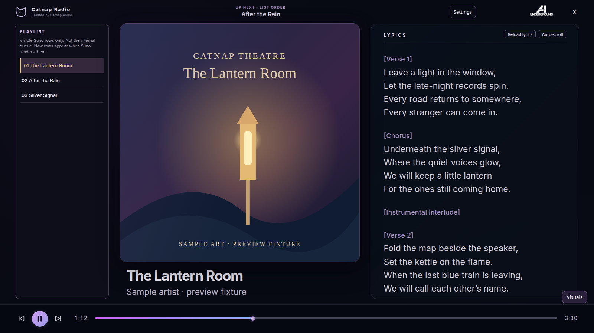

# Catnap Theatre

**Development build 0.4.0 adds a persistent presentation control window and optional now-playing metadata to the music-only broadcaster.** Open Theatre → **Settings → Popout controls**. Both control surfaces use the same settings and visual handlers; closing the control window keeps Theatre running. See the [controls guide](docs/PRESENTATION-CONTROLS.md) and [broadcast pilot guide](docs/BROADCAST-PILOT.md).

A simple theatre overlay for people hosting Suno listening parties. Suno plays the music; Catnap displays the artwork, lyrics, visible playlist and host messages. No AI, Discord bot, uploader account, SSH tunnel or backend service is required.

**This is a separate development package, not a store release.** Version 0.4.0 has been tested in an isolated Chromium profile with synthetic Suno fixtures; it has not been loaded into Ina's user profiles. The currently loaded 0.3.0 extension folder was left unchanged. Install or switch builds between shows, because extension reloads interrupt active capture.

## Try it between shows

1. Use a separate Chrome profile for testing. Do not enable the older Catnap Theatre extension in the same test profile.
2. Open `chrome://extensions`, enable Developer mode and choose **Load unpacked**.
3. Select this repository’s **extension** folder.
4. Open a Suno playlist and sign in through Suno as usual. Press **Catnap Theater** near the lower right.
5. Start the playlist with its ordinary Play control. Open **Settings → Popout controls** for the persistent control window. Inline **Settings** and **Visuals** remain available.

Installing in an already open Suno tab requires a safe page refresh. A refresh can interrupt music. Test before a show, never during a live track.

## What this preview contains

- Artwork + lyrics, playlist + artwork + lyrics, and artwork-focus layouts.
- Contained artwork; a muted copy of an available matching native Suno video, with still-image fallback.
- Approximate lyric following, manual scroll correction, retry, font size and optional `[section / metadata]` line hiding.
- A visible-row playlist that follows Suno’s rendered page without refreshing it; guarded native row Play controls and a current-song marker.
- Local warning/message/image/GIF/video overlays, expiry and recent-file reuse.
- Host name, background colour and tab-local logo/background-image customization; required AIU branding and Catnap creator credit remain visible.
- Extension-local preference storage and a small JSON settings import/export.
- A reusable presentation control window linked to its originating Suno tab, including layout, lyrics, branding, banners and local media.
- Optional music-only broadcasting and bounded public now-playing metadata, independent of whether Theatre is open.
- A separate waiting/pre-show/after-show lounge with explicit Play/Stop AIU Radio, manual next-party text and an optional Suno playlist link.

The visible list is not Suno’s internal playback queue. It cannot promise unseen rows, a refreshed server-side playlist, true lyric timestamps or automatic external-video placeholders. These limits are part of the product contract, not hidden fallbacks.

When broadcasting with a compatible relay, public metadata includes the native
song title/artist, allowlisted Suno artwork, available native timing, a visible
playlist position and up to 100 following visible rows with known durations.
Unknown timing stays unknown; shuffle hides the following rows. The reader sends a five-second
heartbeat; the pilot server expires metadata after 30 seconds without a fresh
update. Audio continues independently if metadata is unavailable. The metadata
reader receives no publish token and cannot control playback.

## Read next

- [User guide and storage](docs/USER-GUIDE.md)
- [Persistent presentation controls](docs/PRESENTATION-CONTROLS.md)
- [Every requested feature: status and acceptance](docs/REQUIREMENTS.md)
- [Architecture and boundaries](docs/ARCHITECTURE.md)
- [Manual acceptance checklist](docs/ACCEPTANCE.md)
- [Release, privacy and distribution draft](docs/RELEASE-AND-PRIVACY.md)
- [Changes and source provenance](docs/PROVENANCE.md)

## Development checks

Install Node.js and npm, run `npm ci --ignore-scripts`, then `npm run check`. No build step is needed to load the extension. The development dependencies are for tests only and are never shipped inside the extension.

The tests verify storage validation, identity guards, shared control settings, source-tab binding, layout settings, visible-row native-play delegation, keyboard safety, metadata projection and approximate lyric motion. Isolated real-browser checks additionally cover popout reuse, file transfer, visual rendering and close/reopen persistence without capture or playback actions. They do not establish live Suno compatibility or store approval. The included screenshot uses original fictional fixture art/lyrics, not a real submission.

## Project family

This is the standalone presentation project. `catnap-radio-hosting` contains the privileged host workflow and prepared browser controllers. Studio and simulcast plans belong to their own research projects. A failure or absence of the hosting backend must not stop this standalone presentation layer.
