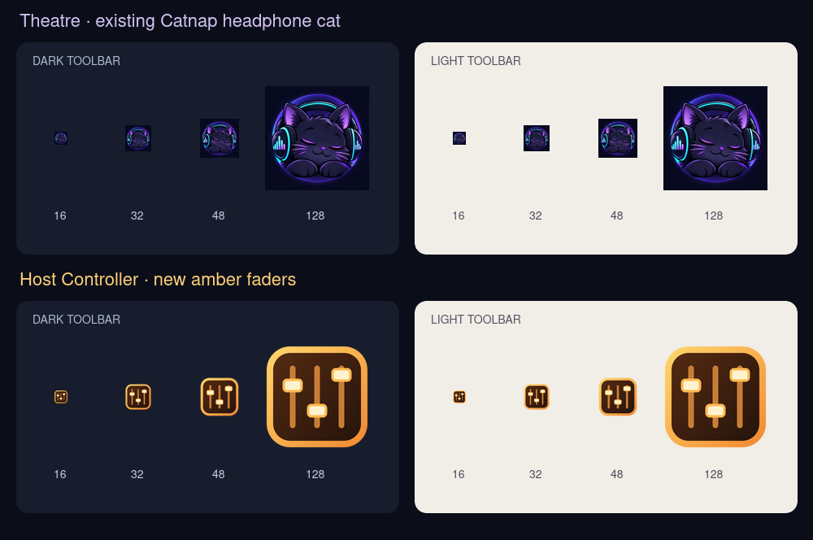

# Theatre toolbar icon — November 12, 2026

Theatre uses the existing Catnap purple/teal headphone cat as its extension and
toolbar icon, with PNG variants at 16, 32, 48 and 128 pixels. The separate
advanced Host Controls extension uses an amber fader icon so the two actions
can be recognized by both colour and shape.

The Theatre toolbar action opens HQ broadcast controls. Theatre's in-page
**Controls ↗** button continues to open the presentation settings window.

After loading the extension, pin it from the browser's Extensions menu. Pinning
is a browser preference. See the official
[action documentation](https://developer.chrome.com/docs/extensions/reference/api/action).

This icon revision keeps the Theatre feature version at 0.5.0. It is prepared
separately from the already working Dev1 source; no automatic profile reload
is performed. The asset renderer is `scripts/render-toolbar-icons.sh`.
